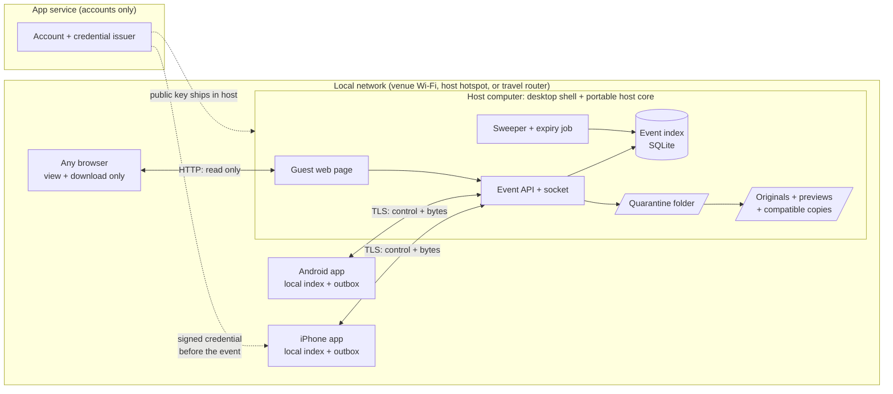
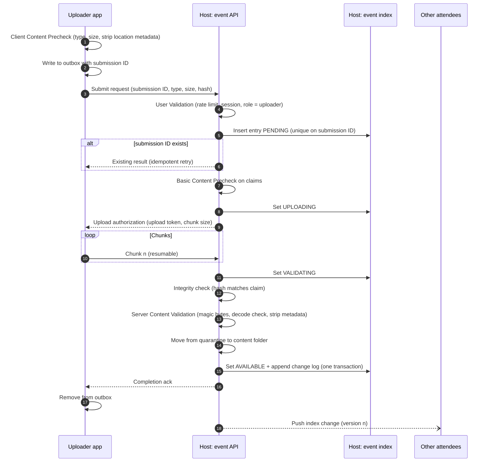
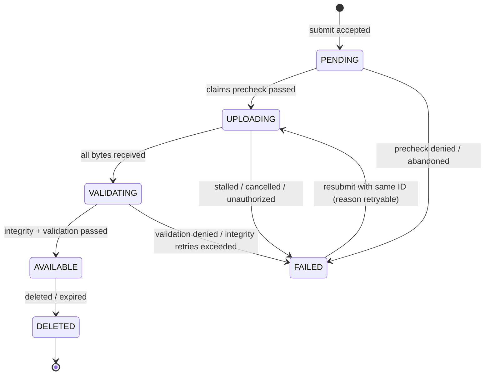

# Locale: MVP Scope and Core Flows

Nov 13, 2026 · Draft for review (rev 2: desktop host first, HEIC handling)

## Purpose

This doc defines the smallest version of Locale that proves the core promise: **people at the same place share full-quality photos across iPhone, Android and computers, with no cloud holding the content.**

**Change in rev 2.** The first host is a **computer** (macOS or Windows), not a phone. The host is written as a portable core so the same code can later run inside the phone apps, which remains the product target. Section 3 (D1, D10) explains why, and section 11 keeps an early phone-hosting spike so the riskiest question is still answered early.

It is built from three sources:

- `Locale notes.md` (the PRD and scratch notes)
- `Locale Content Submission System Design.docx` (the submission pipeline and subroutines)
- `Locale Design Review and System Design Feedback.docx` (the review, which recommends a Phase 1 vertical slice)

The system design doc goes deep on one flow (upload) and is built for Phase 2 and 3: multiple hosts, Bluetooth relays, host failover. The notes cover a much wider product surface that the design doc does not touch. The MVP here is the **Phase 1 vertical slice**: one host device, one content type (photos), and the minimum product around it so a real event can use it.

The notes define Phase 1 hosting as "1 phone acts as data host". The MVP keeps the one-host shape but runs it on a computer first; phone hosting follows in milestone M5 on the same core.

---

## 1. What the notes have that the design doc does not

The design doc covers the content pipeline. Most of the product in the notes has no design yet. This table sorts every major idea into the MVP or later.

| Idea from the notes | In design doc? | MVP decision |
|---|---|---|
| Temp (guest) vs permanent (verified) profiles | Access model only | **In.** Guest can view and download; verified can upload |
| Linked profiles (Spotify, Venmo, Instagram, Drive) | No | Later |
| Friends / connections | No | Later |
| Store profiles (vendor pages) | No | Later (markets/fairs use case) |
| Event listings, keyword search | No | **Partial.** Nearby discovery only; cloud search later |
| Secure events: invite only, password, request + approval | Listed in access model | **Partial.** Open, password, invite link. Request + approval later |
| Proximity / same network / Bluetooth-only events | Listed | **Implicit.** MVP only works on a shared local network, so every event is proximity-bound |
| Event page: description, times, links, invite link, RSVP | No | **In.** RSVP becomes an attendee roster |
| Photo sharing at full quality | Yes (pipeline) | **In.** The core of the MVP |
| Video, audio, large files | Yes (pipeline is generic) | Later (Phase 3 per notes); the pipeline should not block it |
| Screen share, co-watch, Spotify jam | No | Later |
| Chat, private chat ("lo-key"), channels, announcements | Socket note only (T36) | **Partial.** Host-only posts in a Posts tab. Chat, and posts by attendees, later (Phase 2) |
| Feed, threads, comments | Socket note only | Later (Phase 2) |
| Polls / votes | No | Later |
| Location: find each other, find vendors | No | Later |
| Games, points, wagers, generators | No | Later |
| Ledgers (Splitwise-style) | Storage location only | Later |
| Tags, NSFW flag, content restrictions | Tags in pipeline (async) | Later. No tags in MVP |
| Temporary retention per session / per object | Template (T31) | **In, per event only.** Per-object expiry later |
| Extending a session before it expires | No | **In.** Host can extend the end time or retention, up to the 7-day cap (5.9) |
| Refreshing / reopening a session after it expires | No | **Partial.** Reopening as a new, empty event from the old settings is in. Restoring expired content is Phase 2 (5.9) |
| Impromptu sessions, hangouts, night out | Use case only | **In, as a quick session** (5.10): one click on the desktop host in the MVP, on the phone from M5 |
| Sharing documents in work sessions (notes: productivity hub, files) | No | Later. A Files tab with the large-files work (5.10) |
| Hosting limits; hosts joining other events | No | **In.** One hosted event per account; hosts join others as attendees (5.11). Co-hosting is Phase 2 |
| Uploads only by verified accounts | Yes | **In** |
| Posting limits / rate limits | Yes (rate limit first) | **In**, simple per-user limit |
| File scanning, metadata stripping | Yes | **In**, scoped to images (see 5.4) |
| Low-level activity log | Observability (T21) | **In**, local event log on the host |
| User-chosen storage allocation | Host init template (T29) | **In** for the host |
| Join by NFC tap | Template (T34) | Later. QR code covers it |
| Edu-only accounts for classrooms | Use case only | Later |
| Cloud placeholder for events (PRD question) | Open question | Later. See decision D2 |
| Multi-host, Bluetooth relay, host failover, backups | Yes (most of the pipeline) | **Out.** Phase 2 and 3 |
| Computers as participants (README: "any device") | No | **In.** A computer is the first host, the desktop app can join other events as a full attendee, and any browser can join as a view-only guest |
| Phones as the server | Core assumption | **Deferred to M5.** Same host core, embedded in the phone apps |
| Cross-platform photo formats (iPhone HEIC vs Android/web) | No | **In.** Keep the original, add a compatible copy (D11) |

### Where the notes and the design doc disagree

| Topic | Notes say | Design doc says | MVP uses |
|---|---|---|---|
| Retry backoff | Fixed 3 seconds | Exponential | Exponential with jitter, max 3 attempts |
| Terminal states | "Can still be updated" | Payload immutable, metadata mutable (T13) | Payload immutable; delete is a tombstone |
| Rendering | Two options weighed | Local index on client, pushed updates | Local index on client, pushed updates |
| Duplicate content | Flag for manual review | In Review state | No review queue. Same submission ID returns the existing result; same hash from same user returns the existing item |

---

## 2. MVP goal and success criteria

**Goal.** At a gathering of up to 50 people on one Wi-Fi network (venue Wi-Fi, the host computer's hotspot, or a travel router), the host starts an event from a laptop, guests join by scanning a QR code, verified users upload photos from the phone app, and everyone can browse and download them at original quality, on any phone or browser. The event and its photos disappear when it expires.

**Success criteria**

1. An iPhone and an Android phone can both upload to the desktop-hosted event, and each can download the other's photos byte-identical to the original.
2. A photo taken on an iPhone (HEIC) can be viewed in the Android app and on the web page in Chrome, and downloaded as either the original HEIC or a compatible JPEG.
3. A guest can join with no account, from the app or a browser, and download photos; a guest cannot upload.
4. A 12 MP photo transfers host to client in under 5 seconds on a typical home network.
5. New photos appear on every connected attendee's screen within 2 seconds of upload completing.
6. An upload interrupted by a dropped connection resumes, or is retried from the outbox, without user re-selection.
7. No photo bytes ever touch the app service.
8. When the event ends or expires, all photos are deleted from the host, and attendees' cached copies inside the app are removed (downloads saved to the camera roll stay; that is the user's choice).

**Non-goals for the MVP:** phone hosting (M5, right after), multiple hosts, Bluetooth data transfer, relays, video, Live Photo motion, uploads from the browser, chat, feed, polls, location, games, ledgers, cloud event search, Linux host.

---

## 3. Decisions the MVP has to make now

The review says to answer the "what is the server side" question before anything else. For the MVP these are proposed answers. Each is reversible later.

| ID | Question | MVP answer | Why |
|---|---|---|---|
| D1 | What is the "server side" lane? | **The host device** for everything about an event: a computer in the MVP, a phone from M5. **The app service** only for accounts and credentials | Keeps "privacy from the cloud" true: the service never sees content or event data |
| D2 | Should the app service hold an event placeholder? | **No** for MVP. Invites are QR codes and links generated on the host | Removes a cloud dependency; revisit when cloud event search is built |
| D3 | Who holds the bytes while an upload waits? | **The client**, in a durable outbox | There is no server queue; one host means nothing else could hold them |
| D4 | Where do bytes land before validation? | A **quarantine folder on the host**, not served to anyone | Closes T2 and part of T7 |
| D5 | Who scans content? | **The host**, with an image-only allowlist and a decode check (see 5.4) | No cloud scanner exists in this model |
| D6 | Encryption | **In transit, native apps:** TLS between client and host, host certificate fingerprint pinned from the QR code. **In transit, browsers:** plain HTTP on the local network, view-only, with a session token from the QR code (see D12). **At rest:** OS disk encryption (FileVault, BitLocker; later iOS Data Protection, Android file-based encryption) | App-level at-rest encryption adds key management with no extra protection while there is one host. Revisit with backups on other devices. Browsers cannot pin a self-signed certificate, so they get a weaker, read-only role |
| D7 | How are verified accounts checked offline? | The app service issues a **signed credential** (short-lived, e.g. 7 days). The host verifies the signature offline with the service's public key | Events may have no internet; the host still needs to know who is verified |
| D8 | Transport | **Same local network only:** venue Wi-Fi, the host computer's hotspot (Windows Mobile Hotspot works with no internet), or a travel router. mDNS for nearby discovery. Bluetooth is not used in the MVP | Wi-Fi is the only transport fast enough for full-quality media that works across iOS, Android and browsers today |
| D9 | Index concurrency | **Single writer:** the host process writes the index in SQLite transactions | One host means no distributed lock. Closes T5 for now |
| D10 | Host form factor and code | **Desktop host first** (macOS and Windows), built as a **portable Rust core** (event API, index, validation, sweeper) inside a thin desktop shell (Tauri). The phone apps are one **Flutter** app that calls the core through `flutter_rust_bridge`; from M5 the same core also hosts events on the phone. Go with gomobile is a workable alternative. Options weighed: `Locale Design Tradeoffs.md` (TR-1 to TR-5) | A desktop host removes the phone limits (background suspension, battery, storage) while the pipeline, sync and UX are proven. A shared core means phone hosting is a wrapper, not a rewrite. A computer at the event also fits the classroom, work-group and vendor use cases |
| D11 | Photo formats | **Store the original byte-for-byte**, whatever the format. Also generate a **preview** (JPEG thumbnail) at upload and a **compatible copy** (high-quality JPEG) on first request, cached on the host. Clients pick Original or Compatible on download | iPhones shoot HEIC. Android 9+ and Safari open it; Chrome, Firefox, Windows without codecs, Android 8 and below, and many apps do not. Converting the master would break "original quality" |
| D12 | Clients | **Native iOS and Android apps, and the desktop app,** for everyone who uploads (full-quality picker, durable outbox, Save to Photos or to a folder). The desktop app joins and views other events as well as hosting. **Web page served by the host** for view-and-download guests, joined from the QR code. Web join is allowed only for open and invite-link events, never password events | The web page makes "any device" real without an install. Uploading from a browser is unreliable for the core promise: iOS Safari can convert HEIC to JPEG, uploads stop when the tab is backgrounded, and there is no durable outbox. Passwords must not cross plain HTTP |
| D13 | Can a session last longer, or come back after it expires? | **Extend before expiry: yes, in the MVP**, host only, while the host is online, within a 7-day total cap, and every attendee is told. **After expiry: content is gone.** The host can reopen a new, empty event from the old settings. A restore window for expired content waits for Phase 2 | Extending is one field change on the host and fixes a real failure (the party runs late, the festival adds a day). Restoring after expiry means keeping data people were promised would be deleted, and needs a hidden grace state, a consent rule and a backup story that only exists from Phase 2. "Temporary by default" has to mean deleted on time |
| D14 | Should there be a fast way to start small, unplanned sessions? | **Yes: a quick session** in the MVP on the desktop host, on the phone from M5. Same event model with defaults: invite link only, ends when the host ends it or after 12 hours, deleted at the end, convertible to a full event without changing the QR code. Photos only | Covers the impromptu, hangout and work-session use cases from the notes with one button and a defaults preset, not a new system. Invite link only stops strangers on public Wi-Fi from finding it in Nearby. Documents wait because the MVP's safety check only covers images |
| D15 | How many events can a host run, and can they join others? | **One active hosted event per account** (quick sessions count). Hosts **can join and view other events** as ordinary attendees. The host's own phone gets the host role in their event for uploads, posts and deletes; editing, extending, removing attendees and ending stay on the host device | One event per host keeps the server, storage and UI simple. Blocking hosts from other events would be arbitrary, since roles are already per event. Keeping hard-to-undo actions on one device avoids conflicts without needing co-hosting, which waits for Phase 2 |
| D16 | Product analytics, errors and remote config | **PostHog (EU cloud, IP capture off)**, opt-in, metadata only, through one allowlisted telemetry schema in the shared core. MVP: analytics, error tracking, feature flags and remote config (frozen per event by the host), a post-event survey. Session replay off. Full plan: `Locale PostHog Plan.md` | The success criteria and provisional numbers (T9, T12, T17, T22) need field measurement and tuning. One vendor covers analytics, errors, flags and surveys on iOS, Android and Rust. The schema allowlist and opt-in keep "no content leaves the event" true |
| D17 | What can people see before they've joined an event? | **Only what the QR code or Nearby already reveals:** event name, host name, times, access type, and a **generated cover** (an indigo ring pattern derived from the event ID, unique per event). Photo and attendee **counts** only for open and invite-link events, never password events. **Nothing from inside the event** (photos, previews, faces, attendee names, posts) before the access check passes. A host-chosen cover photo is a later option with an explicit "visible to people who haven't joined" warning | Showing photos on the join screen would let anyone on the same Wi-Fi bypass the password, reveal who is there, and reuse photos in a way uploaders never agreed to. Generated art keeps the screen from looking bland with zero content risk |

---

## 4. Architecture

From M5, the "Host computer" box becomes either a computer or a phone running the same core.

### Roles

| Role | Responsibility in the MVP |
|---|---|
| App service | Sign-up, sign-in, issue signed credentials. Never sees event data |
| Host computer | Creates the event, runs the event API, socket and guest web page, owns the event index, validates and stores photos, makes previews and compatible copies, enforces access, runs expiry. The host user can also browse the event in the desktop app |
| Attendee app (iOS, Android, and the desktop app) | Joins, keeps a local copy of the index, renders from it, uploads through an outbox, downloads on demand. The desktop app is both host and attendee client |
| Browser guest | Joins an open or invite-link event from the QR code, views the gallery, downloads Original or Compatible. Cannot upload |

The design doc's "main node" and "host node" are the same device in the MVP. "Index table", "host ID table" and "ID directory" collapse into one **event index** (resolves the glossary question in T23 for Phase 1).

### Why the pipeline still fits

Everything in the design doc's submission flow maps onto this with steps removed, not changed. When only one host exists, host determination is skipped and the main host is used; the design doc already says this. Later phases add hosts and transports behind the same interfaces.

---

## 5. Core flows

Each flow lists its steps, the subroutines it reuses from the design doc, and what it leaves out.

### 5.1 Sign up and sign in

1. User opens the app and chooses **Continue as guest** or **Sign up**.
2. Guest: the app creates a local guest profile (display name, random ID). No network needed.
3. Sign up: email or phone with a one-time code, through the app service. Needs internet.
4. The service returns a **signed credential**: account ID, display name, role `verified`, expiry.
5. The app stores the credential and refreshes it whenever it has internet and the credential is within 2 days of expiry.
6. If the credential expires while offline, the user drops to guest permissions until it refreshes.
7. Browser guests do not sign in. The web page asks for a display name and keeps a random guest ID in the browser for the event.
8. The desktop host app uses the same sign-in. Hosting requires a verified account.

Out of scope: linked accounts, friends, edu accounts, profile photos.

### 5.2 Create an event and start hosting

Simplified from the design doc's Host Node Initialization (T29), for a computer.

1. Verified user opens the desktop host app and clicks **Host an event**. The phone app's Home screen also has **Host an event**. In the MVP it explains that hosting runs on Locale Host for Mac or Windows and offers to send the download link to the user's email; guests see it but are asked to sign up first. From M5 the same button starts hosting on the phone.
2. Enters name, description, start and end time, optional external links, access type (**open**, **password**, or **invite link only**), retention (default: delete 24 hours after the end time), and whether browser guests may join (default on; not offered for password events).
3. Picks a storage allocation (default 20 GB on a computer) and a storage folder.
4. **Capability check:** connected to a network or hotspot on, firewall allows incoming connections on the chosen port (on Windows, prompt to add the rule; on macOS, accept the incoming-connections prompt), free space at least the allocation, and on a laptop, plugged in or battery above 50%. Any failure shows the reason and how to fix it, and blocks.
5. If no usable network exists, offer to turn on the hotspot (Windows Mobile Hotspot) or show instructions for a travel router.
6. The host generates a TLS key pair for the event and starts the event API, socket and guest web page on the local network.
7. It creates the event index and writes the event record (version 1).
8. It advertises the event over mDNS.
9. It shows the **event QR code**, large enough to put on a second screen or print. The QR code holds a URL: `http://<host-ip>:<port>/e/<event-id>#t=<join-token>&fp=<cert-fingerprint>`. The phone app reads the address, token and fingerprint and connects over TLS; a phone without the app opens the same URL in the browser and gets the guest page. The password is never in the QR code.
10. The host window shows attendee count, uploads in progress, storage used, and **End event**. The host keeps the computer from sleeping while hosting.

### 5.3 Discover and join an event

1. Attendee scans the QR code, opens an invite link, or picks the event from **Nearby** (mDNS) in the app. Nearby shows only open and password events.
2. The app connects to the host over TLS and checks the certificate fingerprint against the QR code. For Nearby joins, the fingerprint is shown and trusted on first use.
3. The app sends its credential (verified) or guest profile.
4. **User Validation** on the host (from the design doc): rate limit, then session, then **Access Validation**:
   - Verified credential: signature valid and not expired, else treat as guest.
   - Event access rules: invite token valid, or password correct, or event is open.
   - Not on the host's removed list.
5. Host adds the attendee to the roster with role `host` (the event's host account on another device, see 5.11), `uploader` (verified) or `viewer` (guest), and issues a **session token** bound to this attendee and event, with a TTL (for example 12 hours). The app refreshes it silently while connected. If it expires while the attendee is away, the app re-joins automatically with its stored join token and credential, and the attendee keeps their roster entry; no new scan is needed unless they were removed or the event ended. This is the attendee's connection session, separate from the event's lifetime in 5.9.
6. Host returns the full event index snapshot and its version (flow 5.6).
7. App opens the event page.

**What the join screen shows (D17)**

Before the access check passes, the join screen (app and browser) shows only: the event name, host name, times, access type, the generated cover art, and, for open and invite-link events only, the photo and attendee counts. It says plainly that photos, posts and who's here appear after joining. The host serves nothing else to a device that hasn't passed User Validation and Access Validation.

**Browser guest join**

1. A phone or computer without the app opens the QR URL. The host serves the guest web page over HTTP.
2. The page reads the join token from the URL fragment (fragments are not sent in the request line or logged by the network) and sends it to the host with a display name.
3. The host runs User Validation with role `viewer`. The event must be open or invite-link, with browser guests allowed.
4. The host issues a short-lived session token, scoped to read only, and the page loads the gallery.
5. The page shows a banner: "View only. Get the app to upload and save at full quality."

**Desktop app join**

The desktop app is a full attendee client as well as the host, so a laptop at a work session or classroom can join someone else's event with uploads and original downloads, not just the browser's view-only page. It runs the same client code as the phone apps (local index, outbox, pinned TLS) on the Rust core (D10).

1. The user opens **Events** in the desktop app. It shows:
   - **Your events:** events this computer has joined, plus the event it is hosting, if any, marked **Hosting**.
   - **Join with a link:** paste an invite link (the same URL the QR code holds). Scanning a QR code with the webcam is a later addition.
   - **Nearby:** open and password events on this network, found over mDNS.
2. Joining runs the same steps as the phone app (steps 2 to 7 above): TLS with the fingerprint from the link, or trust on first use for Nearby with the host code shown; User Validation; Access Validation; roster entry with `client_kind = desktop`.
3. Roles are the same as on a phone: verified accounts join as `uploader`, guests as `viewer`. The desktop app's sign-in is optional for joining; it is required only to upload or host.
4. In the joined event the user gets the same Photos, Posts and Attendees tabs, plus desktop conveniences:
   - **Add photos** by drag and drop or file picker, through the normal upload flow (5.4) with an outbox on this computer.
   - **Save** a photo as Original or Compatible (5.5) into a folder the user picks (default: Downloads/Locale/<event name>). Default is Original on macOS and Compatible on Windows, where HEIC may not open without codecs.
   - **Download all originals** of the event into that folder, resumable, skipping files already saved.
5. **Joining while hosting on the same computer:** allowed. The other event must be reachable from the current network; the host app never changes networks or turns off its hotspot to reach it (same rule as 5.11 for phones). The hosted event keeps priority for bandwidth.

Out of scope: request and approval, NFC tap, cloud invite links that work before the host is online, webcam QR scanning.

### 5.4 Upload a photo

This is the design doc's submission flow with the multi-host and relay parts removed. Step names match the design doc so the full flow can be restored later.

**Client side**

1. User picks one or more photos from the camera roll. The picker must return the **original file**, not a converted one:
   - iOS: `PHPickerViewController` with `preferredAssetRepresentationMode = .current`, so a HEIC stays HEIC. The default (`.automatic`) may hand back a converted JPEG.
   - Android: the system photo picker returns the file as stored (HEIC, JPEG, or Ultra HDR JPEG).
   - For a Live Photo, upload only the still image. Motion comes back with video support.
2. **Client Content Precheck:** allowed type (JPEG, HEIC/HEIF, PNG), size under 50 MB, strip GPS and other location metadata without re-encoding the image. Fail: show the constraint error, nothing is sent.
3. Generate a **submission ID** (UUID) and compute a SHA-256 of the stripped file.
4. Write the item to the **outbox** (file copy in the app folder plus a record). From here the upload survives app kill.
5. Show the photo in the event gallery immediately as "Uploading", visible only to the uploader.

**Host side: admission**

6. **User Validation:** rate limit (for example 30 uploads per 5 minutes per user), session token valid, role is `uploader` or `host`.
7. Insert the index entry as `PENDING`. The unique constraint on submission ID decides retries (closes T1). If it exists, return the current state instead of starting over.
8. **Duplicate check, simplified:** same hash from the same user returns the existing item. Same hash from a different user is allowed. No review queue.
9. **Basic Content Precheck** on the claimed type and size, and check the host still has room in its allocation. Fail: `FAILED` with a reason code, reject.
10. Set `UPLOADING`, return an **upload token** bound to submission ID, user, and maximum size (part of T11), plus the chunk size.

**Transfer**

11. The client sends the file in chunks (for example 1 MB) over the TLS connection. Each chunk updates the entry's `last_progress_at` on the host; that is the heartbeat (closes T18 for MVP).
12. On a dropped connection, the client asks the host for the received offset and resumes. **Retry Mechanism:** 3 attempts, exponential backoff with jitter. After that the item stays in the outbox (flow 5.8).

**Host side: content validation**

13. All bytes received: set `VALIDATING`. Bytes are in the quarantine folder and nobody else can see the entry (closes T2).
14. **Integrity:** SHA-256 of received bytes equals the claimed hash. Mismatch: discard and ask the client to re-send, up to 3 times, then `FAILED`.
15. **Server Content Validation, image-only:**
    - Magic bytes match an allowed image type, and the container brand matches for HEIC/HEIF.
    - Decode the image to confirm it is well formed. Decode failure: `FAILED` (fail closed). Decoders by host OS:
      - macOS (and iOS from M5): ImageIO, built in, handles HEIC.
      - Windows: bundled libheif for HEIC, so the host does not depend on the user installing the HEVC codec; the OS decoder for JPEG and PNG.
      - Android (from M5): `ImageDecoder`, which handles HEIC on Android 9+.
      - Run the decode in a separate, sandboxed worker process so a malformed file cannot take down the host.
    - Strip remaining metadata again on the host, without re-encoding. The client strip is advisory.
    - Record width, height, format, and whether the file has an HDR gain map.
    - Generate the **preview**: a JPEG thumbnail (about 1024 px on the long edge) that every client and browser can show.
    - Full malware scanning is deferred. With an image-only allowlist and a sandboxed decode check, the attack surface is the image decoder, which is the same surface every messaging app has.
16. Move the original from quarantine to the content folder, unchanged.
17. In **one SQLite transaction**: set `AVAILABLE`, store the preview path and image facts, append a change-log row with the next index version (closes T6 for MVP).
18. Ack the uploader, then push the change to every open socket (flow 5.6).

The **compatible copy** is not made here. It is made on first request (5.5) so photos that nobody needs in JPEG cost nothing. If the original is already a JPEG or PNG, the original is the compatible copy.

**Host uploads from the desktop**

The host is a verified account with the `host` role, so they can add photos too. In the desktop app they drag photos onto the live event window or click **Add photos**.

1. The host app runs the same Client Content Precheck (type, size, strip location metadata).
2. It submits through the same event API over the loopback address, with its own submission ID. One code path means host uploads get the same validation, state model, change log and fan-out as everyone else's. Only the network transfer is skipped in effect.
3. The file is **copied** into the event's quarantine folder, never moved or referenced in place. When the event expires, Locale deletes its copy and the host's original stays where it was. (The notes considered pointing to the original's path to avoid duplication; for the MVP a copy keeps deletion simple and safe.)
4. Host uploads count toward the event's storage allocation.
5. On Windows, HEIC files from iPhones are handled by the bundled libheif (D11), so the host does not need the HEVC codec installed.

Non-photo files (PDFs, schedules, menus) are out of scope for the MVP, which is photos only. They come with the large-files work, possibly as attachments on host posts.

Out of scope: Suitable Host Determination, Bluetooth and relay Data Stream, async tag generation, In Review, server-side queue, app-level encryption at rest.

### 5.5 Browse and download a photo

From the design doc's read path template (T28), without fallback.

1. The event page renders the gallery from the **local index** and cached JPEG previews. The host is not polled per item.
2. User opens a photo. The client shows the preview, then fetches the full image for viewing:
   - The app on iOS, or Android 9+: the **original**, which it can decode.
   - The app on a device that cannot decode the format, or a browser that cannot show HEIC (Chrome, Firefox, Edge): the **compatible** copy. Safari can show the original.
3. Host checks the session token and that the entry is `AVAILABLE`. Guests are allowed.
4. If the compatible copy is requested and does not exist yet, the host makes it: decode the original in the sandboxed worker, encode a JPEG at quality 92 at full resolution, keep the color profile, store it, and record its path. Concurrent requests for the same item wait on the same job.
5. Host streams the file. Download is resumable by byte range (app only).
6. App checks the hash: against the original's SHA-256 for originals, against the compatible copy's hash (sent by the host) for compatible copies. Mismatch: retry once, then show an error.
7. **Save / Download** offers two choices, with a default based on the device:
   - **Original:** byte-identical to what was uploaded (for example HEIC). Default on iPhone, Mac, and Android 9+.
   - **Compatible (JPEG):** opens everywhere. Slightly lossy, and HDR detail is dropped. Default on browsers without HEIC support, Windows, and older Android.
   - When original and compatible are the same file (the original is a JPEG or PNG), only one choice is shown.
8. In the app, Save goes to the camera roll. In a browser, the file downloads (on iOS it lands in Files; long-press the image to save to Photos).
9. Host records the download and which version in the event log, asynchronously. (In Phase 2 this also registers the downloader as a backup source.)

### 5.6 Event page and index sync

A single-path version of the design doc's Downstream Index Update and Index Sync templates (T15, T32). One host means one delivery path: the socket.

1. On join or reconnect, the client sends its local index version (0 if new).
2. The host compares with the current version:
   - Equal: nothing to send.
   - Client version is in the retained change log: send the changes since then, in order.
   - Otherwise: send a full snapshot.
3. While connected, the host pushes each change as `{version, change}`. Changes are: event updated, event extended or shortened, item available, item deleted, attendee joined or removed, post published or deleted.
4. The client applies a change only if its version is exactly local version + 1. Equal or lower: drop it (idempotent). Gap: request a resync from step 1.
5. Deletions and expiries travel as **tombstones**, so the client removes the item and its cached file.
6. If the socket drops, reconnect with the Retry Mechanism, then resync.
7. Browser guests use the same protocol over a WebSocket and keep their index in memory; on page reload they fetch a fresh snapshot.

The event page shows a header (name, times, links, the deletion time or a status banner), a card with the host's latest post, and three tabs:

- **Photos:** the gallery, with the user's own in-progress uploads shown only to them.
- **Posts:** every host post, newest first, so people who arrive late or scroll away can catch up. System notices (event extended or shortened) appear here too, styled differently. Only the host can post in the MVP. Posts are deleted with the event.
- **Attendees:** the roster with role and photo count.

The Posts tab is the slot where Phase 2's feed and threads will go, so adding them later extends an existing tab instead of restructuring the page.

### 5.7 Delete, moderate, end, and expire

A subset of the design doc's T31 template.

**Delete a photo**

1. The uploader or the host taps **Delete**.
2. Host checks the role, writes a tombstone in the index (new version), deletes the file and preview, logs who deleted it.
3. The tombstone is pushed to all attendees, who remove the item and its cached copy.

**Remove an attendee (host device only)**

1. Host removes an attendee from the host device (5.11). The host revokes the session token, closes the socket, adds the account or guest ID to the removed list, and optionally deletes all of their uploads.

**Edit event details (host device only):** writes the event record, bumps the version, pushes.

**End the event**

1. Host taps **End event** on the host device, or the end time plus retention passes.
2. Host pushes an `event ended` change. Clients delete cached originals and previews for this event and keep only what users saved to the camera roll.
3. Host deletes the content folder (originals, previews, compatible copies), quarantine folder and index, then stops the server, guest page and advertising.
4. If the host computer leaves the network, sleeps, or the host app quits, the event is **paused**, not ended. Attendees see "Host offline". When the host returns, clients resync. If the retention time passes while paused, each client deletes its own cached copies on schedule using the expiry time already in the index.

### 5.8 Recovery: outbox and sweeper

Replaces the design doc's four background flows with two small ones, since there is no server queue and one host.

**Client outbox consumer** (design doc's Client Outbox Consumer, with T17 applied)

1. Runs on app foreground, on network change, on socket reconnect, and every 60 seconds while the event is open.
2. For each outbox item: is the event still active and the session valid? No: mark `Expired` and tell the user.
3. Submit with the same submission ID. The host returns the current state, so a repeat is safe.
4. Up to 10 attempts or 24 hours, whichever comes first, then `Expired` with a **Retry** button.
5. Outbox states the user sees: Waiting for connection, Uploading (n%), Failed (reason), Expired.

**Host sweeper** (design doc's Resolving Stuck Submissions and Failed State Cleanup, merged)

1. Runs every minute inside the host app. One process, so it is a singleton by design (part of T3).
2. `UPLOADING` with no chunk for 2 minutes: set `FAILED` with reason `stalled`, delete partial bytes in quarantine. The client outbox will resubmit with the same ID; the host resets the entry to `UPLOADING` and resumes.
3. `PENDING` older than 10 minutes: set `FAILED` with reason `abandoned`.
4. `FAILED` entries older than 1 hour: delete the row and any residual file.
5. Event past its retention time: run **End the event**.
6. One hour before `expires_at`: notify the host with an **Extend** action (5.9) and push an "expiring soon" notice to attendees.
7. Quick session past its 12-hour limit (or 24 hours with **Keep going**): run **End the event**. One hour before, warn the host (5.10).

### 5.9 Extend or reopen a session

The notes ask for temporary data by default. This flow lets a host keep an event going longer without weakening that promise. D13 records the decision.

**Terms.** An event has an **end time** (when the event itself is over) and a **retention** period after it. `expires_at = ends_at + retention`. At `expires_at` everything is deleted (5.7).

**Extend before expiry (MVP)**

1. The host clicks **Extend** on the hosting window, or on the one-hour expiry warning. Extending and shortening are host-device only (5.11). Choices: +1 hour, +6 hours, +1 day, or a custom end time and retention.
2. Host checks:
   - The host is a `host` role and the event is still `active` (not yet expired).
   - New `expires_at` is no more than 7 days after the event was created (the MVP cap from section 9).
   - Free space is still within the allocation. If it's close, warn but allow.
3. In one transaction: update `ends_at`, `retention_hours` and `expires_at`, increase `extension_count`, append an `event_extended` change with the old and new expiry, write to the event log.
4. Push the change. Every attendee sees a notice: "Photos now delete on <date>." Each client updates its own cache expiry from the new value.
5. Uploaders who don't want their photos kept longer can delete them (5.7). The notice links to **My uploads**.
6. **Shortening** uses the same flow and is allowed any time. If the new `expires_at` is in the past, the event ends now.

Rules:

- Extending works only while the host is online. Nobody else can extend, and clients never extend on their own.
- A client that was offline during an extension may delete its cache on the old schedule. On reconnect it resyncs, sees the new expiry, and re-downloads what it opens. Deleting early is safe; keeping data late is not.
- A paused event (host offline) cannot be extended. If `expires_at` passes while paused, clients delete their caches on schedule and the host ends the event when it comes back.

**Reopen after expiry (MVP, as a new event)**

1. After an event ends, the host app keeps the event's **settings only**: name, description, links, access type, retention, browser guest setting. No photos, roster or index are kept.
2. **Host again** creates a new event from those settings, with a new event ID, new join token, new TLS key and an empty gallery. Old QR codes do not work.
3. Attendees join again by scanning. Nothing from the old event comes back.

This covers recurring use (weekly trivia, a class that meets again) without keeping any content past its promise.

**Restore expired content (Phase 2, not MVP)**

A grace window where an expired event's content is hidden but still recoverable by the host for a short time (for example 24 hours). Deferred because:

- It keeps content past the time attendees were told, so it needs an explicit rule shown at join ("the host can restore photos for up to 24 hours after expiry") and uploader consent.
- It needs a new hidden event state, a sweeper rule for the grace period, and a restore path that re-runs index sync for everyone.
- Attendees' cached copies are already gone, so restore only helps if the host still holds the files. With Phase 2 backups on other devices, deciding what restore means gets harder still.

Related future ideas: auto-extend while attendees are still active, extensions beyond 7 days, per-photo expiry (from the notes), and attendee votes to extend.

### 5.10 Quick session

For small, unplanned sharing: a work session at a cafe, a hangout, a night out. The notes list "impromptu sessions" and "general hang out / night out" as use cases. A quick session is a normal event created with defaults instead of the form, so it reuses every other flow in this doc. D14 records the decision.

**Where it runs**

- **MVP:** the desktop host app, which fits a cafe work session with a laptop.
- **M5:** the phone app's Home screen, which is what a night out needs. In the MVP the phone button explains that hosting runs on a computer, like **Host an event** (5.2).

**Defaults**

| Setting | Quick session | Full event (5.2) |
|---|---|---|
| Name | "<Host first name>'s session · <start time>", renamable | Typed by the host |
| Description, links, times | None | Optional or required |
| Access | Invite link only (never shown in Nearby) | Host's choice |
| Browser guests | On | Host's choice, default on |
| Ends | When the host ends it, or **12 hours** after start at most | Scheduled end time |
| Deletion | **When the session ends** (retention 0) | Default 24 hours after end |
| Storage | 5 GB | 20 GB |

Invite link only is the important default: at a cafe, an Open event would appear in Nearby for strangers on the same Wi-Fi.

**Flow**

1. Verified host clicks **Quick session** (desktop: top of the New event page; M5: phone Home).
2. **Fast capability check**, same checks as 5.2 plus a **reachability test**: the host checks whether other devices on the network can reach it, by testing whether the network blocks devices from seeing each other (client isolation, common on cafe and hotel Wi-Fi).
   - All good: continue.
   - Firewall prompt needed: show it inline, then continue.
   - Isolated network detected or likely: show "This Wi-Fi may block phones from reaching you" with **Turn on hotspot** (Windows Mobile Hotspot; on a Mac, macOS Internet Sharing needs a second network connection, otherwise suggest a travel router) and **Try anyway**.
3. Create the event with the defaults above (`kind = quick`, `ends_at = now + 12 h`, `retention_hours = 0`), start the server, and show the hosting window with the QR code. No form at any point.
4. While running, the hosting window shows "Ends when you end it · auto-ends at <time>" instead of the deletion countdown, with **Rename** and **Add details**.
5. **Add details** converts it into a full event: opens the event form pre-filled, and on save sets `kind = event` with the chosen end time and retention. Same event ID and QR code, so nobody has to rejoin. Attendees see a "Session updated" post if the deletion time changed (5.9 rules apply).
6. **End session** runs **End the event** (5.7): everything is deleted at once, since retention is 0.
7. The sweeper (5.8) ends a quick session at its 12-hour limit. One hour before, the host is warned with **Keep going** (adds up to 12 hours) and **Add details**. A quick session cannot go past 24 hours without converting.
8. A quick session's settings are not saved to Past events, unless it was converted.

**Not in the quick session (MVP)**

- **Documents.** Sharing PDFs, slides or other files is the obvious next want for work sessions, but the MVP's safety check only works for images (D5), and documents need their own view. Planned with the large-files work as a **Files** tab next to Photos, with scanning or a strict allowlist.
- **No-network places** (many bars, outdoors): needs phone hosting (M5) and, without any Wi-Fi or hotspot, Bluetooth (Phase 3).

### 5.11 One hosted event, many joined events

Hosting is a role inside one event, not a type of account. D15 records the decision.

**One active hosted event per account**

1. An account can host one active event at a time. A quick session (5.10) counts.
2. When the account starts hosting, the app service is **not** involved (D1), so the limit is enforced on the account's devices:
   - The host device refuses to create a second event while one is `active` or `paused`.
   - Nothing outside that device knows the account is hosting, so the limit is a product rule enforced by the host app, not a global guarantee. That is acceptable for the MVP: the goal is a clear UI, not stopping a determined user with two computers.
3. While an event is live, **Host an event**, **Quick session** and **Host again** are replaced by "You're hosting <name>" with **Open live event**. Ending the event, or its expiry, frees the slot.
4. Phone app: when the account hosts from a computer, the phone learns it the moment it joins that event as the host (step 6) and shows the same "You're hosting" state on Home.

**Joining other events while hosting: allowed**

5. Outside their own event the host is an ordinary attendee: `uploader` with a verified credential, no host powers. Roles are per attendee per event, already modelled in the `attendee` table.

**The host's own phone in their own event**

6. When an account joins an event it hosts (credential account ID matches the event's host account), it gets the `host` role on that device too, marked as not the host device.
7. What each device can do:

| Action | Host device (computer) | Host's phone |
|---|---|---|
| Upload photos | Yes | Yes |
| Post to the Posts tab | Yes | Yes |
| Delete any photo or post | Yes | Yes |
| Edit event details | Yes | No |
| Extend or shorten | Yes | No |
| Remove an attendee | Yes | No |
| End the event | Yes | No |

The hard-to-undo actions stay on the host device so two devices never compete over the event's lifetime or roster.

**Being in several events at once**

8. The phone app keeps a separate local index, outbox and cache per event (keyed by event ID), so an account can belong to several events. Home lists them as **Your events**, each with its role.
9. Uploads always target one event: the outbox records the event ID, and the picker is opened from that event's page.

**Joining another event from the computer that is hosting (MVP)**

Allowed from the desktop app's **Events** page (5.3, Desktop app join). The hosted event keeps priority and the computer stays on its current network.

**M5: joining another event from a phone that is hosting**

10. Allowed, with a warning: "You're hosting on this phone. Joining another event may slow it down or disconnect your guests."
11. Hosting keeps priority: the phone never leaves its current network or turns off its hotspot to reach another event. If the other event is not reachable from the current network, joining fails with that reason.

Co-hosting (two people hosting one event) belongs with multi-host in Phase 2.

### 5.12 Browse, sort and filter photos

Photos are the main reason people open Locale, so finding the right ones has to be quick on a phone with a few hundred photos. The MVP uses one visible filter (people) and one menu (sort and show), chosen in design review as "Option A" for a cleaner page.

**Layout (Photos tab, phone and desktop)**

1. **Pinned post** above the tabs: the host's most recent post (or a Locale system notice such as an extension), with **All posts** opening the Posts tab.
2. **People row:** "Everyone" first, then each uploader with their initial or avatar, ordered by photo count. Selecting one shows only their photos. One person at a time in the MVP.
3. **Section header** with the current group ("9:30 – 10:00 PM · 14") and a single **sort menu** button on the right ("Newest ▾"). When a "Show" filter is active, the button says so ("Newest · 1 filter").
4. **Grid:** three columns on a phone, more on desktop; the first photo of each group is a large featured tile. Each tile shows the uploader's initial and time (or rank).

**Sort menu**

| Sort | Order | Grouping | Badge on tiles |
|---|---|---|---|
| Newest (default) | Latest first | By 30-minute time blocks | Time |
| Oldest | From the start of the event | By 30-minute time blocks | Time |
| Most downloaded | Total saves and downloads, all time | None (ranked list) | ↓ count and rank |
| Hottest | Saves and downloads in the last 30 minutes, decayed | None (ranked list) | ↑ recent count and rank |

**Show filters** (in the same menu, one at a time): Everything (default), Saved by me, Not saved yet, My photos. "Saved by me" and "Not saved yet" are worked out on the device from its own cache; nothing about what a person saved is sent to the host.

**How the counts work**

- The host already logs each download (5.5 step 9). It keeps `download_count` and a `hot_score` per item (each download adds 1; the score halves every 15 minutes).
- Counts are aggregate only. Nobody, including the host's UI, sees who downloaded a photo.
- Count changes are sent to attendees in batches (at most every 30 seconds) as part of index sync (5.6), so popular photos don't flood the sync channel.
- Counts reset with the event; nothing survives expiry.

**Desktop (joined event and host's gallery):** same people row (as pills with photo counts) and the same sort menu in the section header. No search bar in the MVP.

**Later:** text search (by person name or time, e.g. "Priya 7pm"), multi-person filters, filtering by format (HEIC, HDR), and time-range scrubbing.

---

## 6. Item state model (MVP)

The design doc's model, trimmed to what one host needs. The review asked for a transition table (T13); this is it for the MVP.

| From | To | Trigger | Who | Retryable? |
|---|---|---|---|---|
| (none) | PENDING | Submit passes User Validation | Host | |
| PENDING | UPLOADING | Basic Content Precheck passes, storage available | Host | |
| PENDING | FAILED | Precheck denied (`type`, `size`, `storage_full`) | Host | No |
| PENDING | FAILED | No progress for 10 minutes (`abandoned`) | Sweeper | Yes |
| UPLOADING | VALIDATING | Last chunk received | Host | |
| UPLOADING | FAILED | No chunk for 2 minutes (`stalled`) | Sweeper | Yes |
| UPLOADING | FAILED | Uploader cancels (`cancelled`) | Host on request | No |
| UPLOADING | FAILED | Token invalid (`unauthorized`) | Host | No |
| FAILED | UPLOADING | Same submission ID resubmitted, reason is retryable | Host | |
| VALIDATING | AVAILABLE | Integrity and Server Content Validation pass | Host | |
| VALIDATING | FAILED | Validation denied (`invalid_image`) | Host | No |
| VALIDATING | FAILED | Integrity retries exceeded (`integrity`) | Host | Yes |
| AVAILABLE | DELETED | Uploader or host deletes, or event expires | Host | |

**Invariants**

- Only the host writes item state. Clients send requests and reports.
- Nothing is visible to anyone but the uploader before `AVAILABLE`.
- The payload of an `AVAILABLE` item never changes. Replacing a photo is a new item.
- Every state change and its change-log row commit in one transaction.
- Every loop has a cap: transfer retries (3), integrity retries (3), outbox attempts (10 or 24 hours).

States dropped from the design doc for the MVP: `In Review` (no review queue), `Queued` (the client outbox holds waiting items). Both return with multi-host and scanning in Phase 2.

---

## 7. Data model

**App service**

| Entity | Fields |
|---|---|
| Account | id, display_name, email_or_phone, created_at |
| Credential (issued, not stored long term) | account_id, display_name, role, issued_at, expires_at, signature |

**Host: event index (SQLite)**

| Table | Fields |
|---|---|
| event | id, name, description, starts_at, ends_at, links, access_type, password_hash, retention_hours, expires_at, extension_count, created_at, storage_limit_bytes, version, status (`active`, `paused`, `ended`), kind (`event`, `quick`), max_ends_at (quick sessions: hard limit) |
| event_template (host app, outside the event index) | id, name, description, links, access_type, retention_hours, browser_guests_allowed, last_used_at. Settings only, kept after the event ends for **Host again** |
| attendee | id, event_id, account_id or guest_id, display_name, role, is_host_device (true only for the device running the event), client_kind, joined_at, removed_at |
| item | id, submission_id (unique), event_id, uploader_id, state, reason_code, content_type, size_bytes, sha256, width, height, has_hdr_gain_map, file_path, preview_path, compatible_path (null until made, or same as file_path for JPEG/PNG), compatible_sha256, download_count, hot_score, hot_score_updated_at, created_at, updated_at, last_progress_at, attempt_count |
| change_log | version (primary key), event_id, change_type, payload, created_at |
| post | id, event_id, author_id (host only in MVP), kind (`host`, `system`), text, created_at, deleted_at |
| event_log | id, ts, actor_id, client_kind (`ios`, `android`, `web`), action, target_id, result, reason (joins, denials, uploads, downloads with version, deletes, removals) |

Index on `item(state, updated_at)` for the sweeper (from T19).

**Attendee app (local)**

| Store | Fields |
|---|---|
| local_index (one per joined event) | event_id, mirror of event, attendee, item (AVAILABLE only), post; plus `version` and the user's role in that event |
| outbox | submission_id, event_id, local_file_path, sha256, size, state, attempts, created_at, last_error |
| cache | item_id, version (`original` or `compatible`), path, preview_path |

---

## 8. Screens

**UI rules (from design review)**

- **Accent: soft indigo.** Primary buttons use a periwinkle fill (`#A5B4FC`) with dark indigo text (`#1E1B4B`) in both themes; links and selected tabs use a deeper indigo (`#4F46E5` in light mode) so they stay readable. No red, orange, yellow or green accents.
- **Status colors stay semantic.** Green, amber and red appear only in small status labels and icons (Live, Waiting, Not sent) and on destructive actions, always with a word or icon.
- **Photos are the hero.** Galleries use large tiles in a mixed grid (one featured tile per time group). The only visible controls are a row of people and one sort menu (Newest, Oldest, Most downloaded, Hottest; plus Show filters). No search bar or chip rows in the MVP (5.12).
- **The latest host post is always pinned** at the top of the event page, above the tabs.
- **Nothing from inside an event appears before joining.** Join screens use generated cover art instead of photos (D17).
- **Destructive actions are never next to other actions.** On desktop, End event / End session sits in a separated section at the bottom of the live event page with a one-line explanation; Remove attendee and Delete settings live in each row's ⋯ menu. On the phone viewer, Delete sits apart at the bottom of the save sheet.
- **Verified badges belong to attendees, not the signed-in user.** No "Verified" label next to your own name in headers; instead, verified accounts get an indigo check badge in attendee lists (Event page Attendees tab, host's attendee table). Guests get none.
- **TODO: rename the roles in user-facing copy.** "Host", "Uploader", "Viewer" and "Guest" are functional but flat, and "Uploader" in particular doesn't use the Locale theme of nearby people and local gatherings. The internal role names (`host`, `uploader`, `viewer`) stay; only the labels shown in the app change (badges, the "Join as …" button, attendee lists). Brainstorm candidates before the copy pass, e.g. host → "Local host" or "Anchor"; uploader → "Local" or "Regular"; viewer/guest → "Drop-in" or "Passerby". Pick a set that reads well in "Join as …" and in a badge, and check it on the Join, Event (Attendees) and host screens.

**Desktop app (host and attendee)**

Navigation: **Events** · **Host** · **Past events**.

| Screen | Contents |
|---|---|
| Sign in | Sign in or sign up (verified account required to host or upload; joining as a viewer works without) |
| Events | Your events (joined, plus the one you host marked Hosting), Join with a link, Nearby events with Join; a note when you're hosting that you can still join events on this network |
| Joined event | Pinned host post; Photos, Posts and Attendees tabs; people pills and one sort menu (5.12); photos grouped by time in a mixed grid; Add photos (drop zone); photo panel with Save Original / Compatible to a folder; Download all originals; your role |
| Create event | While an event is live: only "You're hosting <name>" with **Open live event**. Otherwise a **Quick session** card at the top (one click), then the full form: name, description, times, links, access type, password, browser guests on/off, retention, storage folder and allocation, capability check results with fixes (firewall, hotspot, power) |
| Quick session check | Shown only when needed: network reachability result, Turn on hotspot, Try anyway |
| Hosting window | Large QR code (with "Show full screen" and "Print"), attendee count, uploads in progress, storage used, time until photos delete, Extend, **Add photos** (button and drop zone, with the latest photos), new post, attendee table with verified badges and a ⋯ menu per row; **End event** only in a separated section at the bottom |
| Past events | Settings of ended events, with **Host again**; Delete settings in each row's ⋯ menu. No content |
| Event view (your hosted event) | Same Photos, Posts and Attendees tabs as the phone app; edit event |
| Attendees | Roster with verified badges, client kind (iOS, Android, web), and Remove in each row's ⋯ menu |
| Event log | Recent joins, denials, uploads, deletes; Export |

**Phone app (iOS, Android)**

| Screen | Contents |
|---|---|
| Welcome | Continue as guest, Sign up, Sign in |
| Home | **Your events** (every joined event with your role, Host badge on the one you host), Scan QR, **Quick session** and **Host an event** (MVP: point to Locale Host on a computer; M5: host on the phone) or "You're hosting <name>" while hosting, nearby events |
| Event page, host's phone | Same as everyone's, plus a "You're hosting" strip (end and extend from your computer), Write a post in the Posts tab, Delete on any photo |
| Join | Generated cover art with event name and time; counts only for open and invite-link events; host; password prompt if needed; host code on first Nearby join; "photos appear after you join" note; Join as <role> (D17) |
| Event page | Header (name, times, deletion time), pinned host post, tabs: Photos (people row, sort menu, time-grouped or ranked grid), Posts, Attendees (verified badges) |
| Photo viewer | Full-bleed photo, uploader, format and "saved by" badges, Save (Original / Compatible, default by device); Delete (uploader or host) set apart at the bottom of the sheet |
| Upload picker | Multi-select from camera roll, precheck errors inline |
| Uploads | Outbox list with states and Retry |
| Account | Display name, verified status and credential expiry (the only place your own verified status shows) |

**Guest web page**

| Screen | Contents |
|---|---|
| Join | Generated cover art, event name, display name, "View only" and "photos appear after you join" notes, links to get the app |
| Gallery | Photos, Posts and Attendees tabs (read only), photo grid from previews |
| Photo view | Full image (original on Safari, compatible elsewhere), Download Original / Compatible |

---

## 9. Provisional non-functional targets

The review flags that there are no numbers (T22). These are starting targets for the MVP, to be checked in the spike.

| Area | Target |
|---|---|
| Attendees per event | 50 connected at once |
| Photos per event | 1,000 |
| Max photo size | 50 MB |
| Host storage | 20 GB default allocation on a computer |
| Upload, 12 MP photo, LAN | Under 5 seconds |
| Validation + preview, 12 MP HEIC, on the host | Under 1 second on a 2020-era laptop |
| Compatible copy, 12 MP HEIC to JPEG | Under 2 seconds on first request, instant after |
| Index push latency | Under 2 seconds p95 after `AVAILABLE` |
| Join time (scan to gallery) | Under 5 seconds with a 500-item index, app or browser |
| Event lifetime | Up to 7 days including retention |
| Host platforms | macOS 13+, Windows 10/11 |
| Client platforms | iOS 16+, Android 9+ (API 28, built-in HEIC decoding), current Safari, Chrome, Firefox, Edge for the guest page |
| Phone host battery (M5) | Under 15% per hour while hosting with 50 attendees, screen dimmed |

---

## 10. Observability

The minimum from T21, all local to the host.

- **Correlation ID:** the submission ID, carried on every request, log line and state change for that item.
- **Event log** (table above): joins, denials with reason, uploads, downloads, deletes, removals. This is also the "low-level activity log" from the notes.
- **Host panel counters:** attendees connected, uploads in progress, failed uploads in the last hour, storage used.
- **Debug export:** the host can export the event log as a file for bug reports. Opt-in and not sent anywhere automatically.
- **Product analytics and crash reports (opt-in):** PostHog, metadata only, per D16 and `Locale PostHog Plan.md`. The local event log stays the source of truth on the host; PostHog receives only allowlisted, bucketed metadata when a device has internet.

---

## 11. Build order

| Milestone | Scope | Exit check |
|---|---|---|
| M0a. Host core spike | Rust core on macOS and Windows serving TLS and HTTP on the LAN; iOS and Android test apps upload a 50 MB file with resume; HEIC decode and JPEG conversion with libheif on Windows and ImageIO on macOS; iOS picker returns original HEIC | Success criteria 1 and 4 met in test apps; HEIC round-trip verified byte-identical |
| M0b. Phone host spike (parallel, small) | Same core embedded in an iOS and an Android test app, hosting for 2 hours. Measure iOS foreground and background behavior, battery, local network prompts | A written go / no-go for phone hosting, with the limits found. Does not block M1 |
| M1. Accounts and events | Sign up, credentials, guest mode, desktop host app, create event, quick session with reachability check, QR join (app and browser), desktop app join (link and Nearby), access rules, roster, event page with Photos, Posts and Attendees tabs, index sync | Two phones and a browser join a laptop-hosted event and see the same page update live |
| M2. Photo pipeline | Outbox, upload flow, validation, previews, compatible copies, Original / Compatible download, gallery with people filter and sort menu (5.12), state model, sweeper | Success criteria 2, 3, 5, 6, 7 met |
| M3. Lifecycle and hardening | Delete, remove attendee, end and expire, rate limits, event log, firewall and hotspot setup help | Success criterion 8 met |
| M4. Field test | Run at a real gathering of 15 to 30 people, hosted from a laptop | Collect failures from the event log and fix the top issues |
| M5. Phone hosting | Embed the core in the phone apps behind "Host an event", using M0b's findings: hosting mode, capability check for battery, phone storage allocation | The M4 test repeated with a phone as host |

---

## 12. Risks

| Risk | Impact | Mitigation |
|---|---|---|
| A laptop host does not fit parties, hikes and festivals | The MVP only proves the product in settings where someone brings a computer | Keep phone hosting as the target; M0b tests it early and M5 ships it on the same core |
| iOS suspends a phone host's network server when the app is backgrounded (M5) | Event goes offline when the host switches apps | M0b measures it; hosting mode keeps the app in the foreground; event pauses rather than ends |
| Venue Wi-Fi isolates clients from each other (common on public and festival networks) | Phones cannot reach the host | Host computer's hotspot (Windows Mobile Hotspot, or macOS Internet Sharing when the Mac has a second network connection), or a travel router |
| Nearby discovery on Windows (mDNS support varies by version and network settings) | Desktop app on Windows shows an empty Nearby list | Test in M0a; invite links always work as the fallback, and the empty state says so |
| Host OS firewall blocks incoming connections | Nobody can join | Capability check tests the port and walks the host through allowing it |
| Computer sleeps or the lid closes | Event pauses | Host app prevents sleep while hosting and warns that closing the lid will pause the event |
| Cafe and hotel Wi-Fi blocks devices from each other, the most common quick session venue | A quick session shows a QR code nobody can use | Reachability test before the QR code appears, offering the hotspot (5.10) |
| No shared network at all (hiking, festivals without Wi-Fi) | MVP does not work there | Accept for MVP. That case needs Bluetooth or peer-to-peer Wi-Fi, which is Phase 2 and 3 |
| Local network permission prompts confuse phone users | Joins fail silently | Explain before prompting; detect denial and show how to fix it |
| Browser guests use plain HTTP | Anyone on the same network could watch a browser guest's traffic and see the photos they view | Browser guests are view-only and limited to open and invite-link events; native apps use pinned TLS; hosts can turn browser guests off |
| iOS picker returns a converted JPEG instead of the HEIC original | Silent quality loss, breaks the main promise | Set `preferredAssetRepresentationMode = .current`; M0a checks byte-identical round trips |
| HEIC decoding on Windows hosts | Validation and compatible copies fail | Bundle libheif instead of relying on the HEVC codec from the Microsoft Store |
| HEVC patent licensing for a bundled decoder | Legal exposure when distributing commercially | Get licensing advice before public release; on macOS use the OS decoder, which is already licensed |
| Compatible copies drop HDR and are slightly lossy | Users may think Locale lowered quality | Label "Original" and "Compatible" clearly; default to Original wherever the device supports it |
| Android 8 and below cannot decode HEIC | Older phones see only compatible copies | Android 9 minimum for the app; the browser path still works on older phones |
| Image decoder vulnerabilities | Malicious file could exploit the host or a viewer | Allowlist, sandboxed decode worker on the host, strip metadata; add a scanner when content types widen |
| Credential expires during an offline event | Verified user cannot upload | 7-day lifetime, refresh at 2 days left, clear "Viewing only" message |

---

## 13. After the MVP

What comes next, roughly in the order of the notes' phases, and which design doc pieces return with each.

- **Phone hosting (M5):** the same host core inside the phone apps. Brings back the phone parts of Host Node Initialization (T29): battery, power and space checks.
- **Linux host and uploads from the browser:** once the HEIC and background-upload limits in browsers are worked around or accepted.
- **Files tab for documents:** PDFs, slides and other files for work sessions and quick sessions, with scanning or a strict allowlist (5.10).
- **Quick session on the phone (M5):** the night-out case, using the phone's hotspot.

- **Phase 2 content:** text chat, feed and threads (growing out of the Posts tab, with attendee posts and comments), polls. Brings back T36 (sockets for live content) and a thread storage design.
- **Host files beyond photos:** PDFs, schedules and menus, possibly as attachments on host posts.
- **Phase 2 hosting:** multiple fixed hosts. Brings back Suitable Host Determination, backups as read-only copies, Item Fallback (T35), host decommission (T30), conditional index updates with a version column (T5), and the `Queued` state.
- **Phase 3 hosting:** hosts that drop and switch, Bluetooth and relay Data Stream, connection maps. Brings back the full Data Stream and Secure Data Transfer Protocol with per-host tokens (T9 to T11), and authenticated encryption for relayed data (T7).
- **Content types:** video and large files (async large-file path, Bluetooth size gate), then audio and streams.
- **Product:** cloud event listings and search (D2), request and approval access, NFC join (T34), tags and NSFW flags, per-object retention, linked profiles, location, ledgers, games, vendor store profiles.
- **Session lifetime (Phase 2):** restore window for expired content with consent shown at join, auto-extend while attendees are active, extensions past 7 days, attendee votes to extend (5.9).
- **Trust:** manual review (T14), flagged content processor (T33), full malware scanning, per-user quotas.
