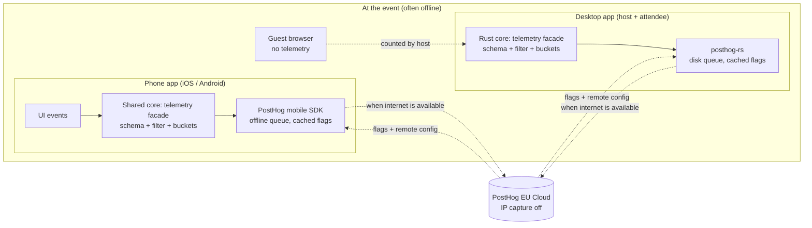

# Locale: PostHog Integration Plan

Nov 13, 2026 · Draft for review · Companion to `Locale MVP Flows.md` (rev 2)

## Summary

PostHog fits Locale well, with one big condition: **telemetry must never carry content, and it has to work around being offline**. Locale's promise is "photos stay on devices at the event, not in the cloud", so any analytics that touches photos, names, posts, locations or event details would break the product's core claim.

Done right, PostHog gives the MVP four things it currently lacks, from one vendor with SDKs for every Locale platform:

1. **Numbers for the success criteria.** The MVP doc defines targets (upload under 5 s, push under 2 s, interrupted uploads resume) but has no way to measure them in the field. PostHog product analytics can.
2. **Error tracking** across iOS, Android and the desktop app, replacing the "debug export" as the main crash signal.
3. **Feature flags and remote config** to tune the provisional numbers (chunk size, stall timeout, retry caps) and to switch off risky features without shipping an update.
4. **Surveys** to hear from hosts after the M4 field test.

Session replay, experiments and the data warehouse wait for later phases, and session replay stays off anywhere content is on screen.

---

## 1. What PostHog offers, and how each product fits Locale

PostHog is an open-source product platform. Its product list changes often; this reflects it as of this writing (check posthog.com before relying on details).

| Product | What it does | Fit for Locale | Phase |
|---|---|---|---|
| Product analytics | Custom events, funnels, trends, retention, paths, cohorts, group analytics | **High.** Activation funnels, pipeline health, per-event metrics | MVP |
| Error tracking | Exceptions and crashes with stack traces | **High.** Crashes across three client platforms and the host core | MVP |
| Feature flags | Boolean and multivariate flags with JSON payloads; local evaluation on server SDKs | **High.** Kill switches, staged rollouts, remote config for thresholds | MVP |
| Surveys | In-app question prompts (API or built-in UI on supported SDKs) | **Medium-high.** Post-event host feedback, field test | MVP (small) |
| Experiments | A/B tests on top of flags with statistical results | **Medium.** Needs more users than the MVP will have | M5 / Phase 2 |
| Session replay | Web and mobile screen recordings with masking | **Low, risky.** Screens are full of private photos | Phase 2, opt-in only, setup screens only |
| Web analytics | Pageview-style analytics for websites | **Low.** Useful for the marketing site, not the app | Any (marketing site) |
| Data warehouse / pipelines | Import external data, export events | **Low** until there's a team and other data sources | Phase 3 |
| LLM analytics | Traces, cost and latency for AI features | **None yet.** Relevant if AI features from the notes (word generators for games) ship | Later |
| Self-hosting | Run PostHog yourself (open source) | **Option** if the privacy story needs "no third-party analytics at all" | Revisit in Phase 2 |

### SDK coverage for Locale's platforms

| Locale component | PostHog SDK | Notes |
|---|---|---|
| iOS app | iOS SDK | Offline queue in file storage, flushed when online; oldest events dropped when the queue is full |
| Android app | Android SDK | Same offline queue behavior as all PostHog mobile SDKs |
| Host core and desktop app (Rust, D10) | `posthog-rs` | Official Rust SDK: capture, feature flags with local evaluation, error tracking (verify the current version's feature set) |
| Desktop UI (Tauri web view) | Not used | Keep one telemetry path through the Rust core instead of a second JS SDK |
| Guest web page | **Not used** | Served from a laptop on a local network with no internet; guests are counted by the host instead (section 4) |

---

## 2. The core tension, and the rules that resolve it

Locale's design decisions D1 and D6 say the app service never sees content or event data, and events usually happen with no internet. Analytics is, by nature, sending data to a cloud. These rules make the two compatible.

**Telemetry rules (non-negotiable)**

1. **Metadata only, never content.** No photo bytes, previews, file names, EXIF, post text, event names, descriptions, links, attendee names or Wi-Fi network names, ever.
2. **Allowlisted schema.** Every event and property is defined in one schema in the shared core. Anything not in the schema is dropped before sending (a `before_send`-style filter on every platform). A new property needs a schema change and a review.
3. **Bucket, don't measure exactly**, where exact values could identify: attendee counts as `1-5`, `6-20`, `21-50`, `50+`; file sizes as `<5MB`, `5-20MB`, `20-50MB`. Timings can be exact (they identify nothing).
4. **No location.** IP capture and GeoIP disabled at the project level. No GPS, no Wi-Fi names, no IP addresses of hosts or attendees.
5. **Pseudonymous IDs.** A random install ID per device. Locale event IDs are salted hashes, so PostHog can group by event without being able to link to one. No emails, phone numbers or account IDs in plain form.
6. **Opt-in.** Onboarding asks once: "Help improve Locale by sharing anonymous usage data" and, separately, "Send crash reports". Both default off; both can be changed in Account. This costs data volume, but it matches the brand: a privacy product that asks first. Re-evaluate with data from M4.
7. **Offline-tolerant.** Events are queued on the device and sent when the device next has internet, which may be hours after the event. Timestamps are recorded at capture time.
8. **EU cloud** with IP capture off (EU organizations default to it off). Self-hosting stays an option if the privacy story later needs "no third-party analytics at all".
9. **Nothing analytics-related ever blocks the product.** If PostHog is unreachable, flags fall back to safe defaults compiled into the app, and capture silently queues.

The privacy policy and App Store privacy labels state this plainly: anonymous, opt-in usage and crash data; no content.

---

## 3. Pros and cons

| Pros | Cons |
|---|---|
| One vendor for analytics, errors, flags and surveys, instead of four tools | Any cloud telemetry is a brand risk for a "no cloud" product; it needs the rules above and clear disclosure |
| SDKs for iOS, Android and Rust cover every Locale component | The guest web page cannot use PostHog (no internet at the event) |
| Mobile SDKs queue events offline and flush later, which suits Locale | Events from offline events arrive late; real-time dashboards lag reality |
| Feature flags with JSON payloads let the team tune the MVP's provisional numbers without app releases | Flags are only as fresh as the last time a device had internet; offline devices run on cached or default values |
| Group analytics maps naturally to "per Locale event" metrics | Opt-in reduces sample size, especially early, which weakens experiments |
| Open source and self-hostable; EU hosting and project-level IP controls | Self-hosting adds operating cost; cloud costs grow with event volume |
| Generous free tier for an MVP (commonly cited: 1M events and 5K recordings per month; confirm on posthog.com/pricing) | Session replay is mostly unusable: screens show private photos, and masking must be proven before any use |
| Error tracking plus product analytics in one place makes it easy to connect a crash to the flow it broke | Another SDK in the app adds binary size, battery and a dependency to audit |

**Verdict:** worth it, scoped to metadata analytics, errors, flags and surveys in the MVP.

---

## 4. Architecture

**One telemetry facade in the shared core.** Clients call `telemetry.track(EventName, typed props)`. The facade checks consent, applies the schema allowlist and bucketing, hashes IDs, adds common properties (app version, platform, client kind) and hands off to the platform SDK. One schema means the iOS, Android and desktop numbers are comparable.

**Persistent offline queue on desktop.** The mobile SDKs persist their queue to disk. On the desktop, confirm whether `posthog-rs` persists events across restarts; if not, the facade writes a small local queue (SQLite, alongside the event index) and flushes through the SDK when online.

**Identity**

- `distinct_id`: a random install ID per device, regenerated if the user resets analytics.
- Anonymous events by default (no person profiles), which is cheaper and more private. If a later phase needs cross-device journeys, link devices with a salted hash of the account ID, only for users who opted in.
- **Group: `locale_event`**, keyed by a salted hash of the Locale event ID. Every device that took part in the same event reports under the same group, so funnels and metrics can be cut "per event" without revealing which event it was.

**Guests and browsers**

The guest page has no internet and no SDK. The host counts guests in its own events: `event_summary` includes `web_guests_bucket`, `web_downloads_count` and the compatible-vs-original split for browsers. Guests are measured in aggregate without any tracking of them.

**Flags at an event: decided once, by the host**

Protocol behavior must be the same for every attendee in one event (an iPhone with a fresh flag and an Android with a cached one must not disagree on chunk size). So:

1. When an event starts, the host reads its flag and remote-config values (fresh if online, otherwise last cached, otherwise compiled defaults).
2. The host freezes them into the event record as `config_version` plus the values that affect the protocol.
3. Attendees' apps use the event's values for anything protocol-related, and their own flags only for UI-only behavior.
4. Every remote-config value has hard bounds compiled into the app (for example chunk size 256 KB–4 MB); out-of-range values are ignored. Security settings (TLS, validation rules, the image allowlist) are **never** remotely configurable.

---

## 5. Event taxonomy (MVP)

Naming: `object_action`, snake_case. Every event automatically carries `app_version`, `platform` (`ios`, `android`, `macos`, `windows`), `client_kind` (`phone`, `desktop`) and, where relevant, the `locale_event` group.

### Activation and joining

| Event | Key properties | Answers | Doc ref |
|---|---|---|---|
| `onboarding_completed` | `path` (`guest`, `signup`, `signin`), `analytics_opt_in`, `crash_opt_in` | How people start | 5.1 |
| `join_attempted` | `method` (`qr`, `link`, `nearby`), `access_type`, `first_time_host` | Which join methods people use | 5.3 |
| `join_succeeded` | `method`, `role`, `duration_ms` (scan to gallery) | Join time vs 5 s target | 5.3, §9 |
| `join_failed` | `method`, `reason` (`local_network_denied`, `fingerprint_mismatch`, `wrong_password`, `unreachable`, `token_expired`, `removed`) | Why joins fail | 5.3 |

### Hosting

| Event | Key properties | Answers | Doc ref |
|---|---|---|---|
| `host_check_completed` | `kind` (`event`, `quick`), `network_ok`, `firewall` (`ok`, `fixed`, `blocked`), `reachability` (`ok`, `isolated`, `unknown`), `power` | How often setup blocks hosting | 5.2, 5.10 |
| `hotspot_offered` / `hotspot_accepted` | `os` | Whether the isolation fallback works | 5.10 |
| `hosting_started` | `kind`, `access_type`, `browser_guests`, `retention_bucket` | Event vs quick session mix | 5.2, 5.10 |
| `quick_session_converted` | `minutes_since_start` | Whether quick sessions grow into events | 5.10 |
| `event_extended` | `amount_bucket`, `extension_count` | How often hosts need more time | 5.9 |
| `event_summary` (host, at end) | `kind`, `duration_bucket`, `attendees_bucket`, `ios/android/desktop/web_share` (percent buckets), `photos_bucket`, `upload_failures_by_reason`, `paused_count`, `ended_by` (`host`, `expiry`, `quick_limit`) | The overall shape of a real event | 5.7 |
| `host_again_used` | `days_since_last` | Repeat hosting | 5.9 |

### Upload and download pipeline

| Event | Key properties | Answers | Doc ref |
|---|---|---|---|
| `upload_completed` | `format`, `size_bucket`, `duration_ms`, `resumes`, `attempts`, `network` (`venue_wifi`, `hotspot`, `router` if known), `from` (`phone`, `desktop_attendee`, `host`) | Upload time vs 5 s target; resume works | 5.4, §2 criterion 4, 6 |
| `upload_failed` | `reason_code` (from the state model: `type`, `size`, `storage_full`, `stalled`, `invalid_image`, `integrity`, `unauthorized`, `cancelled`), `retryable` | Failure mix | 5.4, §6 |
| `outbox_expired` | `attempts`, `hours_waited` | Uploads that never made it | 5.8 |
| `photo_saved` | `version` (`original`, `compatible`), `was_default` (bool), `format`, `platform` | Whether D11 defaults are right | 5.5 |
| `compatible_copy_generated` (host) | `duration_ms`, `format`, `has_hdr` | Conversion cost vs 2 s target | 5.5, §9 |
| `download_all_completed` (desktop) | `photos_bucket`, `duration_ms`, `resumed` | Desktop bulk download health | 5.3 |

### Sync and liveness

| Event | Key properties | Answers | Doc ref |
|---|---|---|---|
| `index_push_measured` (sampled, 1 in 20) | `latency_ms` | Push latency vs 2 s target | 5.6, §2 criterion 5 |
| `index_resync` | `kind` (`delta`, `snapshot`), `reason` (`gap`, `reconnect`, `unknown_version`) | Whether sync is healthy | 5.6 |
| `host_offline_seen` (attendee) | `minutes_offline_bucket` | How often hosts drop | 5.7 |

### Forbidden in any event

File names, photo hashes, event names or IDs in plain form, display names, post text, links, Wi-Fi names, IP addresses, GPS, exact attendee counts, exact file sizes, free-text fields of any kind.

---

## 6. Dashboards and insights (MVP)

**1. MVP success criteria** (mirrors section 2 of the MVP doc)

| Insight | Type | Target |
|---|---|---|
| Upload duration, 12 MP-class photos (`upload_completed.duration_ms`, size 1–20 MB) | Trend, p50 / p95 | p50 < 5 s |
| Index push latency (`index_push_measured`) | Trend, p95 | < 2 s |
| Join time, scan to gallery | Trend, p50 / p95 | < 5 s |
| Upload success rate, by platform | Formula: completed / (completed + failed non-user) | > 98% |
| Uploads needing a resume that still completed | Ratio | > 95% |
| Compatible copy generation time | Trend, p95 | < 2 s |

**2. Activation funnels**

- Attendee: `onboarding_completed` → `join_succeeded` → first `photo_saved` or `upload_completed` (same `locale_event`).
- Host: `host_check_completed` → `hosting_started` → `event_summary` with `attendees_bucket` ≥ `6-20`.
- Quick session: `hosting_started` (kind quick) → first attendee → `quick_session_converted` or ended by host.

**3. Setup friction:** breakdown of `host_check_completed` by `firewall` and `reachability`, and `join_failed` by `reason` and `platform`. This is where the doc's top risks (client isolation, firewall, local network permission) become visible.

**4. Format decisions:** `photo_saved` split by `version` × `platform` × `was_default`. If Windows users often override Compatible to Original, change the default.

**5. Errors:** error tracking issues by platform and release, linked to the pipeline step from the event that preceded them.

---

## 7. Feature flags and remote config (MVP)

| Flag | Type | Default (compiled) | Purpose |
|---|---|---|---|
| `browser_guests_available` | Boolean | On | Kill switch for the guest web page if a security issue appears |
| `quick_session_enabled` | Boolean | On | Hide quick sessions if the reachability check misbehaves |
| `reachability_test_mode` | Multivariate: `full`, `fast`, `off` | `full` | Tune the cafe Wi-Fi check |
| `compatible_copy_strategy` | Multivariate: `on_demand`, `eager` | `on_demand` | Switch to making JPEGs at upload time if first-request latency is bad |
| `desktop_download_all` | Boolean | On | Kill switch for bulk downloads |
| `transfer_config` | JSON payload | `{chunk_kb: 1024, stall_timeout_s: 120, retry_max: 3, backoff_base_ms: 500}` | Tune the numbers the review said were missing (T9, T12), within compiled bounds |
| `outbox_config` | JSON payload | `{max_attempts: 10, max_hours: 24}` | Tune outbox limits (T17) |
| `rate_limits` | JSON payload | `{uploads_per_5min: 30}` | Tune per-user limits |

Rules: compiled defaults always exist; values are frozen per event by the host (section 4); out-of-range values are ignored; security and validation settings are not flags.

---

## 8. Error tracking (MVP)

- Capture crashes and handled exceptions on iOS, Android and the Rust core, with the user's crash-report consent.
- Scrub stack frames and messages of paths that contain event or file names (for example `~/Locale/Events/<name>/`). The facade replaces them with placeholders before sending.
- Tag every error with the pipeline stage (`join`, `upload`, `validate`, `convert`, `sync`, `expiry`) and `reason_code` where known.
- The host's sandboxed decode worker (5.4) reports decoder crashes as errors with format and size bucket only. A spike here is an early warning of a malformed-file attack.

---

## 9. Surveys (MVP, small)

- **Host, after `event_summary`:** "How did hosting go?" (1–5) and one multiple-choice "What got in the way?" (`Wi-Fi`, `people couldn't join`, `uploads were slow`, `nothing`, `other`). No free text in the MVP, to avoid people typing names or event details.
- **Attendee, after first `photo_saved`, at most once:** "Did your photos come through at full quality?" (yes / not sure / no).
- Shown when online after the event, never during it.

---

## 10. Session replay: off in the MVP

Replay records the screen. Nearly every Locale screen shows other people's photos, names or posts, so replay is off everywhere in the MVP. In Phase 2 it can be considered under strict conditions:

- Opt-in beta testers only, with a separate consent.
- Only on screens without content: onboarding, host setup and capability checks, the quick session Wi-Fi check, settings.
- All images and text masked by default; masking verified with tests on every release (PostHog's own docs warn that screenshot-based mobile replay can capture sensitive content if masking misses a view).
- Never on the event page, viewer, uploads, posts or attendee screens.

---

## 11. Phases

### Phase 0: before M1 (design work)

- Decide and record: EU cloud vs self-host, opt-in wording, the telemetry rules (section 2). Add decision D16 to the MVP doc.
- Write the event schema (section 5) as code in the shared core, with the allowlist filter and bucketing.
- Privacy review of the schema; draft the privacy policy section and App Store privacy labels.
- Exit: schema merged; a test proves forbidden properties are dropped on every platform.

### MVP (M1–M4): measure, fix, tune

| Area | What ships |
|---|---|
| Product analytics | Activation, hosting, pipeline and sync events from section 5, with the `locale_event` group |
| Dashboards | Success criteria, activation funnels, setup friction, format decisions (section 6) |
| Error tracking | iOS, Android, Rust core; scrubbed; stage-tagged |
| Feature flags | Kill switches and remote config (section 7), frozen per event |
| Surveys | Post-event host survey; one attendee question |
| Field test (M4) | Every M4 event produces an `event_summary`; the dashboards are the field test report |

Exit: the MVP success criteria can be read off a dashboard from real events, and at least one provisional number (for example `chunk_kb` or `stall_timeout_s`) has been tuned through remote config.

### M5: phone hosting

| Area | What ships |
|---|---|
| Staged rollout | `phone_hosting_enabled` flag, rolled out by platform (Android first or iOS first, based on M0b findings), then by percentage |
| New events | `hosting_paused_background` (iOS suspension), `host_battery_drop` (percent-per-hour bucket), `hotspot_hosting_started` |
| Comparison | Desktop-hosted vs phone-hosted events: join failures, upload times, paused counts, `event_summary` shape |
| First experiments | Home screen: Quick session vs Host an event prominence; onboarding copy for Local Network permission |

Exit: a go / no-go for phone hosting by platform, based on the comparison dashboard.

### Phase 2: social features and multiple hosts

| Area | What ships |
|---|---|
| Engagement analytics | Posts, chat, feed and threads: stickiness, retention cohorts ("hosts who host again within 30 days"), lifecycle |
| Experiments | Feature-level A/B tests now that there is enough volume (opt-in sample permitting) |
| Session replay | Opt-in, setup screens only, under section 10's conditions |
| Multi-host health | Host failover count, backup promotions, item fallback success (design doc T35) |
| Surveys | Feature-specific prompts (chat, feed) |
| Self-host review | Decide whether to move to self-hosted PostHog for the privacy story |

### Phase 3: mesh, relays and new content types

| Area | What ships |
|---|---|
| Transport analytics | Transfer path mix (Wi-Fi, Bluetooth, relay hops), relay success rates, throughput by path; tunes the Data Stream thresholds (T9, T10) |
| Video and large files | Async upload completion times, Bluetooth size-gate deferrals |
| Data pipelines / warehouse | Export aggregated events to a warehouse if a team needs joined analysis with app store or support data |
| LLM analytics | Only if AI features from the notes (prompt generators for games) ship |

---

## 12. Risks

| Risk | Impact | Mitigation |
|---|---|---|
| A property slips through that contains content or identity | Breaks the brand promise; possible legal exposure | Schema allowlist in the core; automated tests; review for any schema change |
| Opt-in rate is low | Too little data for decisions or experiments | Clear, honest prompt that shows what is sent. PostHog can't see users who declined, so estimate the opt-in rate by comparing opted-in installs with App Store and Play Console install counts |
| Offline events arrive days late | Dashboards lag; time-based trends skew | Use capture timestamps; read field-test results a week after the events |
| Flags disagree between devices at one event | Protocol mismatches | Host freezes protocol config per event (section 4) |
| Remote config misused or compromised | Dangerous values pushed to every client | Compiled bounds; no security settings in flags; PostHog account protected with SSO and 2FA |
| Session replay leaks photos | Severe privacy incident | Off in the MVP; Phase 2 only under section 10's conditions |
| Rust SDK gaps (offline persistence, features) | Lost desktop events or missing features | Facade owns the queue; verify the SDK's features in M0a |
| Cost growth | Bills scale with events | Anonymous events, sampling for high-volume events (`index_push_measured`), event-level summaries over per-photo events where possible |

---

## 13. Talking points for the PostHog interview

- **The interesting problem is privacy plus offline, not dashboards.** Locale is a stress test of PostHog's privacy controls (EU hosting, IP capture off, filtering before send, opt-in APIs, anonymous events) and of SDK behavior offline (mobile offline queues, flag caching).
- **Group analytics as the core model.** Locale's unit of value is an event, not a user; `locale_event` groups make per-event funnels possible without identifying anyone.
- **Flags as distributed config.** Freezing flag values per event on the host is a pattern any offline or peer-to-peer product needs.
- **Measuring guests you can't track.** Aggregating browser guests on the host is a way to measure a population without instrumenting it.
- **Questions to ask them:**
  - How do the mobile SDKs persist flag values across app restarts when offline, and how long are cached values trusted?
  - Does `posthog-rs` persist its queue to disk, and is there a recommended pattern for long offline periods (days)?
  - How do anonymous events and group analytics interact in pricing and querying?
  - What do teams building privacy-first or on-device products most often get wrong with PostHog?

---

## Sources

- [PostHog privacy controls](https://posthog.com/docs/product-analytics/privacy)
- [iOS SDK configuration (offline queue)](https://posthog.com/docs/libraries/ios/configuration)
- [Best mobile app analytics tools (PostHog comparison; offline queues on all mobile SDKs)](https://posthog.com/compare/best-mobile-app-analytics-tools)
- [Mobile session replay (masking caveats)](https://archive.posthog.com/docs/session-replay/mobile)
- [PostHog Rust SDK docs](https://posthog.com/docs/libraries/rust) and [posthog-rs on docs.rs](https://docs.rs/crate/posthog-rs/0.25.2)
- [PostHog pricing](https://posthog.com/pricing) (free-tier figures above are as commonly cited by third parties, e.g. [Schematic](https://schematichq.com/blog/posthog-pricing); confirm on PostHog's page)
